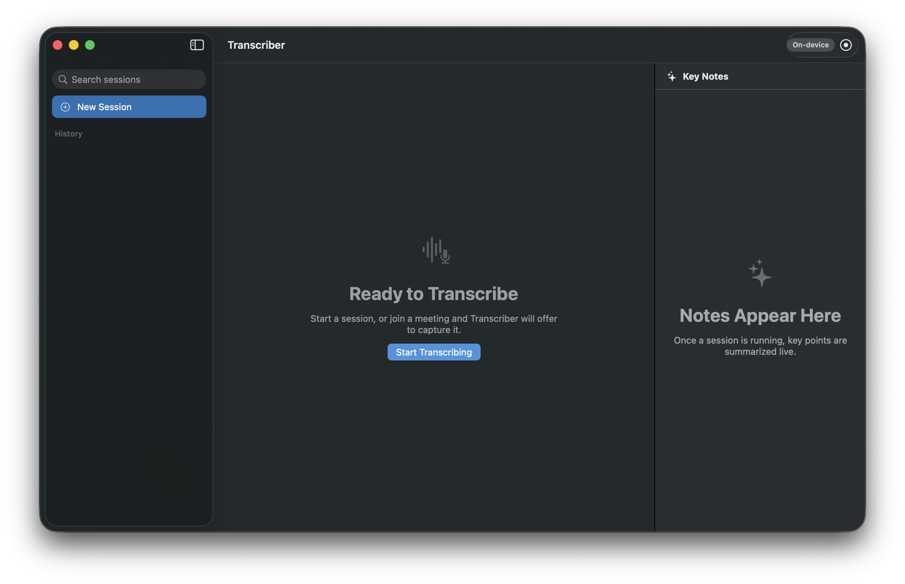
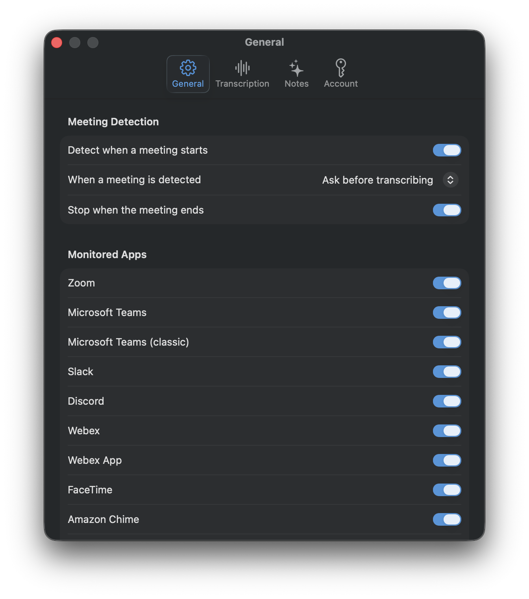

# Transcriber

Native macOS meeting transcription with **on-device speech recognition**, **local speaker
diarization**, **automatic meeting detection**, and **live AI key notes** — in a two-column
Liquid Glass UI built for macOS 26 (Tahoe).

> **Privacy stance:** everything runs on-device by default. Audio is never written to disk
> (transcript-only persistence), and speaker identification *always* runs locally even when
> the optional OpenAI cloud transcription engine is enabled.

## Screenshots





## Features

- **Real-time transcription** of both sides of a meeting:
  - Your microphone (echo-cancelled) is transcribed as **You**
  - System audio (the remote participants) is captured via a Core Audio process tap
  - Live "volatile" text renders as a low-opacity tail and finalizes in place
- **Speaker diarization, always local** — FluidAudio LS-EEND (CoreML) separates remote
  participants into Speaker 1…N in streaming mode; click any speaker chip to rename
- **Meeting auto-detection** — watches which apps are actively using the microphone
  (Zoom, Teams, Slack, Webex, FaceTime, Discord, Chime, browsers; configurable).
  Get a notification / in-app banner ("Start transcribing?") or full auto-start
- **Live key notes** — the right column maintains a rolling AI summary (decisions, action
  items, open questions). The prompt is **fully user-editable** in Settings → Notes
- **Engine choice**
  - ASR: Apple `SpeechAnalyzer`/`SpeechTranscriber` (default, on-device) or OpenAI
    Realtime over WebSocket (`gpt-realtime-whisper`, text only; auto-falls back to
    on-device if the cloud drops)
  - Notes: Apple Foundation Models (on-device) or OpenAI Responses API with response
    storage disabled
- **Sessions & export** — searchable history (SwiftData, crash-safe incremental writes),
  Markdown export of notes + speaker-attributed transcript
- **Menu bar presence** — status, elapsed time, start/stop without opening the window
- Pause/resume (`⌘⇧P`), stop (`⌘.`), start (`⌘R`), editable session title, level meters,
  onboarding flow with one-time model pre-download

## Requirements

- macOS 26 (Tahoe) or later, Apple Silicon
- Xcode 26 + [XcodeGen](https://github.com/yonaskolb/XcodeGen) (`brew install xcodegen`)
- Optional: Apple Intelligence enabled (for on-device notes), or an OpenAI API key
  (for cloud transcription and/or cloud notes)

## Alpha status

This repo is a public source-available alpha. The supported alpha path is source checkout
plus local build on macOS 26; downloadable app bundles are development-signed or ad-hoc
signed unless a separate Developer ID/notarization pass is completed. Real Google Meet/Zoom
validation, live OpenAI ASR validation, and notarized distribution remain tracked in the
release checklist and roadmap.
The current prerelease is `v0.1.0-alpha.1`; it publishes source archives only, not a
user-installable app binary.
For a reproducible local alpha package, run `scripts/build-alpha-release.sh` and follow
the validation steps in [docs/ALPHA_RELEASE_CHECKLIST.md](docs/ALPHA_RELEASE_CHECKLIST.md).

## Build & run

```sh
xcodegen generate                                            # .xcodeproj is gitignored; project.yml is source of truth
scripts/sync-package-lock.sh --verify                        # confirms generated SwiftPM lock matches Package.resolved
xcodebuild -scheme Transcriber -configuration Debug -derivedDataPath build build
open build/Build/Products/Debug/Transcriber.app
```

Tests:

```sh
xcodebuild -scheme Transcriber -derivedDataPath build test
```

Run `xcodegen generate` again whenever source files are added or removed. The checked-in
root `Package.resolved` is the canonical SwiftPM lockfile; see
[docs/DEPENDENCIES.md](docs/DEPENDENCIES.md) for the package update workflow.

### Code signing

No Apple Developer Team is checked in. Local Xcode builds can use ad-hoc signing or your
own development team. A stable signing identity matters for repeated local testing because
macOS TCC permission grants are tied to the signed app identity.

The app is **not sandboxed** and hardened runtime is off for development - Core Audio
process taps and per-process mic monitoring are friction-prone under sandbox.

## Permissions

| Permission | Why | When asked |
|---|---|---|
| Microphone | Transcribe your side | First session (or onboarding) |
| System Audio Recording | Transcribe remote participants (process tap) | First session |
| Notifications | "Meeting detected — start transcribing?" prompts | Onboarding |

Settings → General has a **permissions health** panel with System Settings deep links.
If notifications are denied, the in-app banner and menu bar fallback cover detection prompts.

## Settings overview

- **General** — meeting auto-detection on/off, prompt vs auto-start, auto-stop when the
  meeting ends, monitored apps, permissions health
- **Transcription** — engine (on-device / OpenAI), language (from
  `SpeechTranscriber.supportedLocales`), cloud model id
- **Notes** — engine (automatic / on-device / OpenAI), update cadence, **editable
  summarization prompt** with reset-to-default
- **Account** — OpenAI API key (Keychain), connection test

## Architecture

See [docs/ARCHITECTURE.md](docs/ARCHITECTURE.md) for the full design. The short version:

```
Mic (AVAudioEngine + AEC) ───────────► ASR A ──► "You" segments ─┐
                                                                 ├─► Assembler ─► Transcript UI
System audio (Core Audio tap) ──┬────► ASR B ──► text+times ─────┤        │
                                └────► LS-EEND diarizer ─► speaker timeline   └─► NotesCoordinator ─► Notes UI
                                       (overlap merge in SpeakerAttributor)
```

Key invariants:

- Mic and system audio stay **separate end-to-end**, so "You" needs no diarization and the
  diarizer only separates remote voices
- Engines emit text with **fed-audio timestamps**; a per-stream `TimelineMapper` converts to
  the pause-aware session clock (the tap emits nothing during silence, so this is required)
- Diarization is engine-independent: switching ASR engines (or mid-session cloud→local
  fallback) never changes how speakers are identified

## Privacy

See [docs/PRIVACY.md](docs/PRIVACY.md) for the exact local persistence, optional OpenAI,
Keychain, permissions, and debug-artifact model.

## Development hooks

`defaults write dev.local.transcriber <key> -bool YES`:

| Key | Effect |
|---|---|
| `debugAutoStart` | Start a session automatically at launch |
| `debugAudioDump` | Write per-stream WAVs to `~/Library/Application Support/Transcriber/debug/` |
| `debugDiag` | Append pipeline diagnostics to `…/Transcriber/debug/diag.log` |

A handy end-to-end smoke test without a real meeting:

```sh
say -v Samantha "First speaker says something." && say -v Daniel "Second speaker replies."
```

Both voices arrive via the system tap, get transcribed, and should be split into
Speaker 1 / Speaker 2.

## Roadmap

See [ROADMAP.md](ROADMAP.md).

## License

This project is source-available, not open source. See [LICENSE](LICENSE).

## Security

Please do not include private meeting content, API keys, debug audio dumps, local stores,
or logs in public issues. See [SECURITY.md](SECURITY.md).
